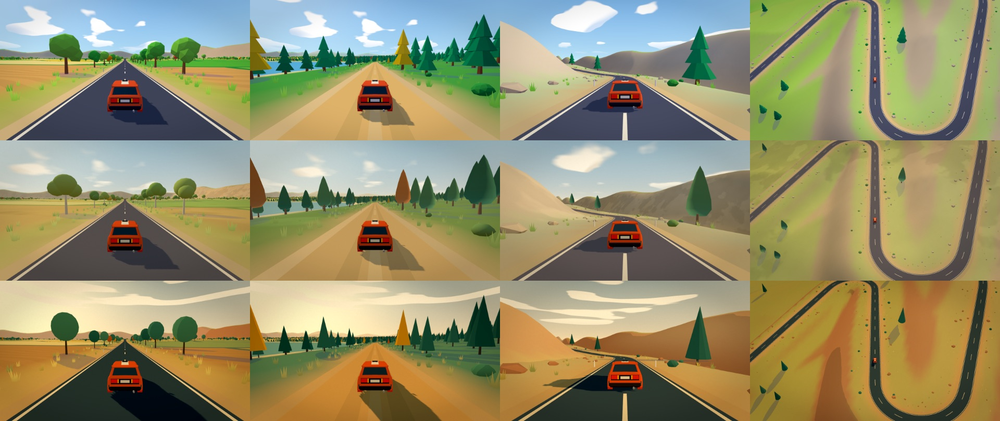

# Beyond the Bend

An open-road driving game in development, aimed at a Steam release as a standalone indie game. Two things live in this repository:

- **Graybox driving slice** (current work): https://perinchiang.github.io/beyond-the-bend/slice/
- **Painted diorama prototype** (frozen): https://perinchiang.github.io/beyond-the-bend/

## 项目定调 / Direction · 2026-11-19

**目标（Patrick 原话）：** 美术风格像《art of rally》，玩法像《极限竞速：地平线》；上架 Steam，成为一款独立游戏；精美好看，车辆操控不错。

**对地图和玩法的四条要求：**

1. 平时多一些一两公里的直路；
2. 偶尔来一点只需要松油门或者轻点刹车就能通过的路口；
3. 特殊地形可以设计一些连续弯道和漂移；
4. 拥有不同生态地图的玩法。

### 已定

- **技术栈不换。** Three.js + TypeScript + WebGL 2；Steam 外壳用 Electron + steamworks.js。先例是 [Slow Roads](https://store.steampowered.com/app/3431300/Slow_Roads/)：Three.js、单人开发、程序化道路和地形，2026-09 上架 Steam。若灰盒在目标硬件上性能不过关，再评估换引擎，那时要迁移的只有灰盒。
- **顺序：先证明地图和手感，再做美术。** ① 灰盒驾驶切片 → ② Steam 外壳 → ③ 美术切片 → ④ 更多生态、活动与车辆 → ⑤ 商店页与试玩 Demo。
- **镜头：** 巡航默认低位追尾，能看到地平线；高位俯视可切换。
- **冻结，不删：** 送货、Mara、金币、车库、通行进度、邮局村庄、六个分区样段。不再投入，也不作为新工作的前提。

### 未定

- **画风。** 由 Patrick 看到灰盒和美术切片之后决定。已知偏好：不要 Slow Roads 那样偏写实；要有自己的一套，好做，一眼看上去靠谱好玩。现有地面的色块表现是 Patrick 认可过的。候选方案在美术切片里用同一段路、同一镜头并排比较；讨论中的候选不等于已批准，灰盒的纯色画面也不代表任何方向。
- [issue #3](https://github.com/perinchiang/beyond-the-bend/issues/3) 的笔触研究暂停。其中的验收规则（在驾驶镜头里看动态、不靠景深和雾遮问题、环境用代码生成、不靠建筑填内容）在第 ③ 步使用。

**文档优先级：** Patrick 最新明确要求 → 本节 → [灰盒切片 issue #4](https://github.com/perinchiang/beyond-the-bend/issues/4) 的记录。[ROADMAP.md](ROADMAP.md) 是送货主线时期的历史文档。

## Graybox driving slice

A 5.1 km square map with 26.7 km of road, a force-based car and a low chase camera, with no art direction applied: flat colours, cones for trees. It exists to answer three questions before any art is made: is the map the right shape, is the car good to drive, and does a world this size run on the hardware a Steam release has to support. Status, measurements and open questions are in [issue #4](https://github.com/perinchiang/beyond-the-bend/issues/4).

```bash
npm install
npm run dev          # then open http://127.0.0.1:5183/beyond-the-bend/slice/
npm run test:slice   # map facts, a test driver on every road, 52 vehicle checks (no browser needed)
npm run shots:slice  # screenshots and frame times (set BTB_URL; needs Chrome)
npm run shots:looks  # the same views through every art look, tiled into shots/looks/sheet.png
```

| | |
|---|---|
| `W A S D` / arrows · `Space` | drive · handbrake |
| `V` | view: **Chase → Far chase → High** |
| `R` · `M` · `Esc` | back on the nearest road · large map · pause |
| `1`–`7` | jump to a test spot (numbered on the map) |
| `P` | autopilot (follows the road you are on) |
| `L` | next art look, at the same spot (see below) |
| `` ` `` · `H` | frame times and telemetry · hide the help |
| Gamepad | RT / LT · left stick · A or X handbrake · Y reset · RB view · LB autopilot |

URL options: `?look=graybox|flat|gouache|print`, `?spawn=1..7`, `?at=x,z,headingDeg`, `?view=0|1|2`, `?stats=1`, `?auto=1`, `?dpr=<max pixel ratio>`, `?shadows=0`, `?mute=1`, `?hud=0`.

### The map

| Road | Length | What it is for |
|---|---|---|
| Ring | 12.6 km | Fast tarmac loop. South straight 2.65 km, north straight 1.68 km. Bends are R 480–520 m (flat out), R 280–300 m (lift) or R 180–220 m (light brake). |
| Meridian | 3.6 km | North–south through the middle: two flat-out kinks and a jump. Joins the ring at both ends through R 200 m wyes. |
| Lakeside | 4.7 km | Gravel sweepers, R 110–250 m, past the lake and through the forest. |
| Pass | 4.4 km | Narrow tarmac over the massif, 21 → 180 m. Esses of R 45–75 m on the way up, two R 22 m hairpins on the way down. |

Roads are laid out the way real ones are ([alignment.ts](src/slice/world/alignment.ts)): straight tangents between hand-placed points, a bend of a chosen radius at each point, eased in and out by clothoid spirals. The design speed of every bend is therefore an input. The layout is data in [network.ts](src/slice/world/network.ts); change it and run `node tools/slice-world.mjs`.

Each road's height follows the land averaged over a distance (long on straights and fast sweepers, short in tight bends), takes the height of any earlier road it meets, and holds a grade limit; the terrain is then cut and filled to the road ([world.ts](src/slice/world/world.ts)). Jumps are authored: a 5 % ramp, a 25 m crest and a 5 % landing slope. On the pavement the car rides on the road profile exactly; off it, on the same 4 m height grid that is drawn. Trees are solid.

### The car

[vehicle.ts](src/slice/vehicle/vehicle.ts): a rigid body on four suspension rays, tyre forces with a grip peak, rear-biased all-wheel drive, six gears, air time and obstacle impacts, stepped at 240 Hz. Keyboard steering is wound on progressively, as in the diorama prototype, and the front wheels are turned into a slide for the driver. Every tunable is in `DEFAULT_SPEC`, each with a note on what the player feels when it goes up or down.

Measured by `node tools/slice-handling.mjs`: 0–100 km/h in 5.7 s, 230 km/h top speed, 1.3 g on tarmac and 0.9 g on gravel, 100–0 km/h in 30 m. These numbers say the car meets its targets. They do not say it is fun; that needs driving.

### Art look studies

Patrick drove the graybox on 2026-11-19 and approved the car, the camera and the map for now (his notes are in [issue #6](https://github.com/perinchiang/beyond-the-bend/issues/6)). The next question is the art. Three candidate directions are drawn over the same map, car and camera so they can be compared on the same road. **None of them is chosen.** Without `?look=` the slice stays graybox.

| | Try it | Idea |
|---|---|---|
| **A · Flat** | [`?look=flat`](https://perinchiang.github.io/beyond-the-bend/slice/?look=flat) | Bright midday. Saturated colour blocks, faceted trees in tiers, violet shadows, crop fields in a patchwork. Every object is one or two flat colours and reads at a glance. |
| **B · Gouache** | [`?look=gouache`](https://perinchiang.github.io/beyond-the-bend/slice/?look=gouache) | Soft afternoon. Muted pigments, painted washes on the ground, round crowns on pale trunks, warm haze, paper grain. Continues the ground treatment approved in the diorama. |
| **C · Print** | [`?look=print`](https://perinchiang.github.io/beyond-the-bend/slice/?look=print) | Low golden sun. Five or six inks, light in hard steps, haze in flat layers so hills stack like a travel poster, clouds as level bars. |



Rows: A, B, C. Columns: plains straight, lakeside gravel, the pass, the hairpins from the High view.

A look is data ([looks.ts](src/slice/render/looks.ts)): palette, light, sky, tree shapes, ground treatment and a finishing pass. Everything is generated in code; there are no image or model assets besides the car. Field parcels and painted washes are computed in the terrain shader, trees and roadside growth are small procedural meshes tinted per instance, and the sky and clouds are one shader.

These are studies, not production art: foliage has no levels of detail (the gouache look draws up to 2.6 million triangles in the forest), trees cast only a soft blob shadow, each look has one fixed time of day, and nothing reacts to the car. All three hold 60 fps on an Apple M2; nothing else has been measured.

### What is not there

No touch controls, quality presets, events or progression (only jump, drift and speed-trap readouts). Sound is a placeholder synth. Performance has been measured on an Apple M2 only. Beyond about 2 km a road can be hidden by simplified terrain, and trees appear abruptly at 3 km.

## Painted diorama prototype (frozen)

Everything below describes the earlier prototype at the repository root page. It still builds, runs and deploys, and its delivery loop, characters and regional studies are kept, but no further work is planned on them.

Stack: Three.js (r187) · TypeScript · WebGL 2 · Vite. Environment: code-first procedural geometry and shaders; vehicle: Blender Python → GLB.

### Run

```bash
npm install
npm run dev          # http://127.0.0.1:5183/beyond-the-bend/
npm run build        # type-check + production bundles for both pages (tools/build.mjs)
npm run car          # regenerate public/models/car.glb with Blender (needs `blender` on PATH)
```

### Controls (current prototype)

| | |
|---|---|
| `W A S D` / arrows | drive (steering is always relative to the car) |
| `Space` / `Shift` | service brake / handbrake |
| `E` (driving) | use the nearby delivery, gate or challenge |
| `C` | switch **Driving camera** ⇄ **Free camera** |
| `V` | cycle driving view: **High → Normal → Close** (Driving camera only) |
| drag / `Q E` · `R F` · wheel / `Z X` · shift-drag | orbit · tilt · zoom · pan (**Free camera only**) |
| `T` | miniature lens on/off |
| `H` | hide the legend |

Driving sound starts on the first keyboard or touch gesture. Web Audio synthesizes the engine, tyre noise and grass rustle from the car’s speed, throttle and ground contact. Open **Pause** to freeze the drive and mute driving sounds. **Resume drive** continues from the same position and speed. The mute preference is remembered on this device.

The upper-left HUD shows speed in km/h and a north-up road map. The red arrow tracks the car, including off-road, and the diamond marks the current destination. Tap **Map** to collapse it. With `?debug=1`, the upper-right **Debug** selector lists the build ID and travel points for all routes.

### Existing route and delivery experiment

The following describes how the existing experiment works, not a required delivery-first player journey.

The main entrance starts in Close view at the village exit. Follow the hayfield road through its broad bend to the clock tower at Foothill Station (306 m), then keep driving to return through the hills. Stop by the village envelope sign, choose **Talk to Mara** (or press **E**), then sign for the station parcel. You can leave the counter before signing. The first station delivery earns 100 coins. Bring the porter's timetables back to Mara for a stamped receipt and another 35 coins. The pause menu holds the guide switch, garage, engine tune and unlocked passes. Return mail offers a trip back to town. At the end of the rice fields the left fork leads through Cedar Pass to the old sawmill. This 303 m gravel road crosses a timber bridge over Mill Brook and rejoins the original road on the north ridge. The first delivery adds guidance through the fields; the physical junction is always open. The remaining districts and Sunset Arcade are separate playable studies reached at their marked exits. The old hill sprint starts at the meadow bend. The local logbook saves purchases, deliveries and event records. Reloading starts the current map at its entrance. Use `?route=circuit` for the earlier road layout in gouache. For the earlier diorama, use `?study=original`. The [Close comparison](public/studies/close.html) includes the oil, print and gouache studies.

URL options: `?cam=free`, `?preset=0|1|2`, `?s=<metres along the road>`, `?q=low|high`,
`?tilt=0`, `?stats=1`, `?hud=0`, `?haze=<0..1>`. `?lens=ortho` restores the old parallel projection
(used by `tools/stability.mjs`, and handy for comparing the two).

A standard gamepad uses the left stick to steer, RT for throttle, LT for braking, the west face button for the handbrake and the south face button to interact. In the touch layout use **Slide** for the handbrake.

Run `npm run test:journey` against the local dev server to exercise deliveries, driving guidance, the garage, six road passages and the timed sprint. Set `BTB_URL` to check a production deployment. Run `npm run package:desktop` for a self-contained offline HTML build in `test-results/desktop/`. On macOS with Xcode command line tools, the command also builds a local WebKit app.

### Cameras

Both modes look through the same long "miniature" lens — a real perspective telephoto, not a
parallel projection.

- **Driving (default)** — locked behind the car; the road runs up the screen and the car sits a
  little below centre. No orbit, tilt, zoom or pan: the rig ignores those inputs. The view follows
  the car's position exactly and turns with it through one critically damped spring: no dead zone,
  no overshoot, and quick steering corrections are mostly filtered out. Presets:

  | preset | tilt | lens | view height at the car | car position | yaw time constant |
  |---|---|---|---|---|---|
  | High | 55° | 36° | 66 m | 13 % below centre | 0.60 s |
  | Normal | 40° | 30° | 44 m | 18 % below centre | 0.52 s |
  | Close (station road) | 22° | 30° | 24 m | 23 % below centre | 0.45 s |

- **Free / photo** — orbit, tilt, zoom and pan. It follows the car's horizontal position immediately,
  smooths only height over grade changes, and does not track its heading.
  Entering it changes nothing on screen (the driving pose is handed over as-is); leaving it eases
  back behind the car.

The camera only reads the car's pose. `tools/camera-test.mjs` replays a fixed input script with and
without constant mode/preset switching and checks the vehicle ends in a bit-identical state.

#### Why the lens is not orthographic

The first versions used a parallel (orthographic) projection. Still frames looked fine, but in
motion — above all while the view turned to follow the car — the ground on both sides seemed to
tilt and curl upward, as if the road ran along the bottom of a bowl, and the scenery seemed to be
dragged round the car. The terrain was not the cause: measured across the whole lap, the land
beside the road is on average slightly *below* it.

A parallel projection has no vanishing point and no size falloff, so a rotating view carries no
cue for which way the ground is tilted (the same ambiguity as the "spinning dancer" illusion), and
every point pinwheels round the car with the screen edges sweeping fastest. Through a real lens
land recedes and shrinks with distance, the ground reads as flat, and a turn reads as the camera
swinging round behind the car — distant land slides across like an ordinary pan.

[art of rally](https://store.steampowered.com/app/550320/art_of_rally/) and
[Absolute Drift](https://store.steampowered.com/app/320140/Absolute_Drift/) were the references:
both look down through a perspective lens from high behind or above the car, keep the route
readable and keep camera motion smooth. These were references for the existing lens and camera
comfort, not approval to replace the art direction. The current implementation has three driving
presets and adds aerial haze so distance reads as distance, shadows
fitted to the lens's footprint, and a stippled dissolve for any tree crown that drifts between
the lens and the car. Handling and input mapping are unchanged.

### Handling

A simple arcade model, tuned to be forgiving with all-or-nothing inputs (keys, touch buttons):

- **Steering is wound on, not switched on.** A held key reaches full lock in about 0.3 s and
  unwinds twice as fast. A quick tap therefore gives a small nudge (an 80 ms tap moves the car
  about 0.35 m sideways over the next second, a 150 ms tap about 1 m) while a held key still
  turns hard.
- **The same key means the same thing at any speed.** Above walking pace the lock shrinks with
  speed so that full lock asks for about 2 g of cornering — a 12 m bend at 15 m/s, a 36 m bend
  flat out — and never more than 80°/s of rotation.
- **A little weight.** The body follows the front wheels with a short lag rather than snapping.
- **Grass slows the car gradually.** The verge is free; beyond it the car bogs down over about
  0.7 s and frees itself in 0.25 s. Clipping the grass costs about 1 % of your speed, cutting
  a corner for a second about 8 %, and staying out there settles at roughly two thirds of
  road speed. Grip is slightly lower on grass.

Acceleration, top speed and braking are as before. `npm run test:handling` measures all of
this and laps the road with a tap-steering keyboard driver that has human reaction time.

### How the picture is made (current implementation)

This is an inventory of the current mixed implementation, not a claim that every asset already
matches the ground. The terrain's layered washes and restrained strokes are the starting point
for the research issue. Sharing `paintMaterial()` does not automatically give trees, props and
cars the terrain's paint treatment: their geometry, colour hooks and lighting adjustments differ.

| Layer | Source |
|---|---|
| Terrain shape | Procedural height field (fBm + one authored hill and dip), 320×320 grid. The road corridor is cut in with a distance field so verges are flat and embankments ease into the hills. |
| Road | Two hand-authored closed Catmull-Rom splines: the station road and the original 1.3 km circuit. A ribbon mesh carries exact lateral coordinates, so edge lines and dashes are analytic and stay crisp. |
| Terrain paint | Custom GLSL injected into Three's Lambert material: broad gouache washes, brush-dab edges, short grass ticks, dry-brush grain, painted form shading from terrain curvature, earth shoulders, drifting cloud shadows, and a stippled dissolve into paper at the world edge. |
| Textures | World-space noise and brush strokes are baked at startup. Two small Canvas2D atlases hold birch sprays and the broadleaf, fir and thorn brush shapes. |
| Vegetation, rocks | Round-shouldered oak, lime and plum crowns on painted bark, open fir boughs and arching thorn shoots use species-specific silhouettes and painted edges. Low fieldstone ledges share a broken mineral seam across their faces, with moss and grass at the base. Geometry is instanced in 100 m chunks. |
| Roadside | Delineator posts, corner chevrons (placed from spline curvature), post-and-rail fences — one merged mesh. |
| Car | `tools/blender/build_car.py`: a lofted hatchback shell from hand-tuned cross-sections, boolean wheel wells, arch flares, inset glazing, lamps, bumpers, spoiler, lamp pod, separate spoked wheels (~6k triangles). Colours are assigned in code by material name. |
| Light | One warm directional sun with a texel-snapped PCF shadow map and cool hemisphere fill. Tree crowns use authored volume normals and do not receive shadow-map shadows; shrubs, ground cover, rocks and buildings have separate shadow settings. |
| Lens | A 30–36° perspective lens with aerial haze beyond the focal plane. One post chain: half-resolution tilt-shift blur, soft highlight roll-off, mild grade and vignette. |

### Existing village art experiment

At the village post office, a pale clay pull-in leads from the asphalt to the parcel counter beneath a double-sided envelope sign. The four cottages and the orchard use a local gouache treatment. Pigment follows the plaster and roof planes. Along the road, white birches alternate between a swept crown, an open fork and a taller leader; oaks spread sideways and limes grow upright. The [paint on each bough](src/art/postal-orchard.md) supplies its edge and brush marks, while the scene's sun places the gold on the lit side, even on the return drive. The two small pigment and foliage textures are embedded in the build, including the offline version. The station, hills and other routes keep their existing art. This local treatment, including its generated-image foliage atlas, is an experiment to evaluate, not the default production standard for future environments.

### Checks

```bash
npm run shots                 # capture review screenshots into shots/ (needs dev server + Chrome)
node tools/observe.mjs        # drive a stretch on autopilot and tile the frames into a filmstrip
node tools/postal-light-check.mjs # check the same crown under sunlight from opposite sides
node tools/camera-test.mjs    # camera modes, presets, transitions, vehicle independence
node tools/stability.mjs      # pan the camera a whole number of pixels and compare re-aligned frames
npm run test:comfort          # view turning, what the lens does to distance and to turns, terrain profile
npm run test:handling         # key taps, held keys, grass excursions, keyboard-driven laps (no browser needed)
npm run test:mobile           # touch controls and desktop input at a mobile viewport (dev server required)
```

The browser tools read `BTB_URL` (default `http://127.0.0.1:5183/beyond-the-bend/`).

### Known limitations

- Desktop Chrome checks cover synthetic touch input and mobile-sized layouts. **Not tested on real iPhone Safari**; native multi-touch capture, notch safe areas and sustained performance still need device testing.
- Driving uses a simple arcade model with a separate handbrake/slip implementation; trees and props are not solid. The current car follows sampled terrain height rather than simulating a complete airborne/suspension cycle. Convincing crest take-off and landing remain targets to implement and validate.
- In the Close view a tree crown between the lens and the car is thinned out in stipples rather
  than hidden cleanly, and the diorama's paper edge can show at the top of the frame as a pale sky.
- Trees are not shadowed by other trees, there is no level-of-detail for foliage, and the leaf dabs
  look blocky in extreme close-up.
- A small main map plus separate regional studies, not a broad continuous multi-biome world. Vehicle variants reuse the base car GLB; they are not a collection of independently modelled cars. Large-world streaming and sustained target-device performance remain unvalidated.

### Play on mobile

Public game: https://perinchiang.github.io/beyond-the-bend/
Repository: https://github.com/perinchiang/beyond-the-bend

Open the game in Safari and rotate to landscape; no installation is needed.
Touch controls appear on devices with a coarse pointer:

- Hold ◀ / ▶ at bottom-left to steer. Release to ease back toward neutral.
- Touch the vertical throttle at right and slide up/down for 0–100% power.
  Position determines power; releasing returns it to zero. Coasting still carries the car forward.
- Hold **Brake** beside the throttle to slow down.
- Steering, throttle and brake accept separate fingers simultaneously.
- Open **Pause** and tap **Driving / Free** to switch cameras. In Free mode, drag the scenery to orbit.
- In **Pause**, tap **High / Normal / Close** to cycle the driving view. This button is disabled in Free mode.

Keyboard controls are unchanged. Touch input resets on cancellation, capture loss, backgrounding,
window blur and resize/rotation. Safe-area insets keep controls away from the notch/home indicator.
On mobile the existing low-quality preset is selected by default (1024px shadows, existing reduced
scatter/paint settings and tilt blur off); DPR is capped at 1.5 and rendering at 1.6 million pixels.
The same painterly shader/post-processing pipeline is retained. Desktop quality defaults are unchanged.

### Deployment

The Pages workflow builds with Node 22 and npm ci, then publishes dist using GitHub's official
Pages actions. Every push to main deploys; workflow_dispatch allows manual redeployment.
Vite defaults to /beyond-the-bend/ locally. CI uses configure-pages' base_path, so the generated
scripts, styles and car GLB share the correct Pages prefix. The GLB uses import.meta.env.BASE_URL.

In repository **Settings → Pages → Build and deployment**, the source must be **GitHub Actions**.
Actions must be enabled for this repository. The deploy job requires pages:write and id-token:write;
if an organization restricts these, an administrator must allow the official Pages actions and
approve the github-pages environment. Never publish credentials in the repository.

For a local production check:

    npm run typecheck
    npm run build
    npm run preview -- --port 5184
    # Open http://127.0.0.1:5184/beyond-the-bend/

The exported browser-context function in tools/mobile-check.mjs can be passed to a browser
runner's page.evaluate after window.__btb.ready. It checks analog values reaching the vehicle,
simultaneous inputs, independent releases, pointer cancellation/capture-loss events, blur/resize,
camera buttons, desktop keys, camera/vehicle independence, control bounds and the GLB path.
It temporarily stubs capture for synthetic pointers and forces coarse-pointer CSS for inspection;
reload after running. It does not prove native Safari pointer capture or real-device performance.

